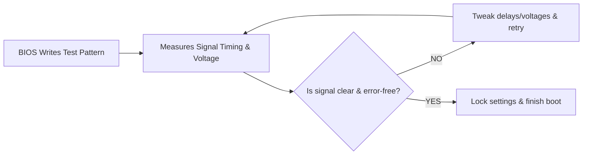

## What is Booting Up?

It is the complete process that follows when a computer is powered on up to the login prompt appearing on screen.


## Power On $ \rightarrow $ Firmware Initialization

Pressing the *Power On Button* wakes up the Power Supply Unit (PSU) which generates several *voltage rails* (electrical distribution pathways) like `+12V, +5V, +3.3V` which power components like CPU, RAM, SSD, etc. While these voltages are stabilizing, the motherboard actively holds the CPU in a hardware **Reset State** using a physical electrical pin (`RESET`). Once the voltages become stable, the motherboard releases the CPU from hardware reset state by sending a `Power Good` signal, causing the CPU to awaken into a 16-bit **Real Mode** to begin executing instructions.


It is the initial operating state of all x86-compatible processors upon booting. This is the mode in which firmware (BIOS) executes.
- Uses 16-bit general purpose registers to manipulate data.
- Uses 20-bit physical address bus, limiting the total addressable memory space to 1MB of RAM.


### CPU Reset State

Initially, the CPU has no idea about where anything is. This state is called reset state. The CPU begins execution from a predefined address, hardcoded into the processor, called **reset vector**. This address is mapped to the firmware stored in the ROM (Read Only Memory) / Flash memory on the motherboard. The CPU loads this address into the program counter to start execution of the code. As the RAM is not yet initialized, the motherboard chipset's address-decoding logic is hardwired to redirect access to the reset vector to the Flash chip.


- x86 : `0xFFFFFFF0`
- ARM : `0x00000000` (or `0xFFFF0000` when high-vector mode is enabled; on modern AArch64 CPUs the reset address is implementation-defined)


> Now the execution is handed off to the **firmware** in the Flash memory (Non-volatile memory, retains its content even when the system is powered off) on the motherboard.

### Firmware

It can be defined as a piece of software programmed directly into a non-volatile memory on the motherboard. It initializes the hardware, runs diagnostic tests, finds and loads the bootloader into memory (RAM).

- It is written for specific hardware.
- It can be updated only by flashing the memory chip.
  - Completely wiping the existing blocks of data on the **Electrically Erasable Programmable Read-Only** memory chip `EEPROM`.
  - Writing the new compiled binary image file directly onto the clean sectors of the chip.

#### BIOS vs UEFI

**BIOS** & **UEFI** both are firmware. Both perform the same job of initializing the hardware and starting the OS, but they represent different generations. BIOS is text based legacy firmware while UEFI is modern graphical successor.

|BIOS|UEFI|
|---|---|
|16-bit environment|32/64-bit environment|
|Boots from MBR|Boots from EFI System Partition (ESP)|
|Limited to 2.2 TB disks|Supports 9.4 ZB disks|
|Minimal User Interface|Rich interface with mouse support|
|No Secure Boot|Secure Boot is Supported|
|Legacy|Modern|

---

> Now the control is handed over to firmware. The booting process is different for both BIOS & UEFI till GRUB comes into the picture. So first let's cover `BIOS`.

---

## BIOS (Basic Input/Output System)

### POST (Power-On-Self-Test)

BIOS initializes & executes system diagnostics to verify hardware integrity before enabling full system operations.

#### 1. Cache-as-RAM (CAR)

Right now the DRAM (Dynamic Random Access Memory) / memory is uninitialized and unusable. To solve this issue, the fast SRAM (Static RAM) which is integrated into the CPU in the form of L1/L2 Cache (which are functional the instant the CPU gets powered on) is treated as a temporary memory block. This gives the CPU a functional stack & heap to execute compiled C code needed for BIOS work. This trick is called **Cache-as-RAM (CAR)**.

#### 2. Memory Initialization (MRC - Memory Reference Code)

It is the RAM initialization process of BIOS. Every RAM stick has a small 8-bit EEPROM chip called **SPD chip** (Serial Presence Detect). CPU uses a slow primitive serial bus (I2C) running at a few hundred kHz to read the raw bytes inside the SPD chip. It tells the BIOS about:
- Memory type
- Voltage requirement

To enable high-speed communication with the RAM (~6000 MT/s), some calibration must be done as the motherboard's copper traces are susceptible to errors due to capacitance, nanosecond propagation delays, etc. This signal calibration is called **Memory Training**. It is done to prevent the CPU from reading garbage values.

##### Memory Training



Among other things it fine-tunes the exact voltage levels used to distinguish a 1 from a 0, making sure noise or interference doesn't trigger false readings.

> When a new RAM is installed, the electrical characteristics of the specific motherboard and RAM are not known and thus the first boot takes so long because the perfect configuration is being brute-forced.

Once memory training is finished, MRC calculates total usable capacity & every byte of detected RAM is mapped into a contiguous address space. This is called **Sizing**.

##### CAR Teardown

Now that the real system DRAM is calibrated and usable, BIOS transitions from CAR to DRAM. MRC carves out space for BIOS execution stack and other structures inside real DRAM. Stack and Heap states are copied and stack pointer and base pointer registers are updated to map to the new physical address inside DRAM. L1/L2 caches stop faking RAM behavior and resume their native job: *acting as hardware write-back cache for physical RAM*.

> With this, BIOS exits its primitive initial stage and starts running on full system RAM.

---

#### 3. CPU Initialization

- Patches silicon bugs: BIOS checks CPU's identity via `CPUID` and applies runtime microcode patches stored in BIOS ROM.
- Defines Cache Rules: MTRRs (Memory Type Range Registers) are configured to tell the CPU how to handle different memory regions.
  - Caching regular RAM for speed and disabling caching for hardware devices.
- Wakes Multi-Cores: System boots on a single main core. BIOS sends a sequence of interrupts to wake up all extra cores and verify they are working.

#### 4. Peripheral & Bus Enumeration

Now that the CPU and memory are initialized, BIOS performs **Bus Enumeration**.


- It is the communication pathway that connects the processor, memory & hardware parts.
- PCI (Peripheral Component Interconnect) & PCIe (PCI express) are used to plug/connect parts like GPUs, storage into the motherboard.
- PCIe is the modern standard, while PCI is legacy.


Bus Enumeration is the discovery process where firmware walks the PCI/PCIe topology, discovers every device and gives it a way to talk to the CPU.

> `Bus:Device.Function (BDF)` is a coordinate system used to find and talk to hardware parts.
> - Bus is the main internal data highway.
>    - Bus 0 is connected directly to the CPU.
> - Device is a specific piece of physical hardware on a highway.
>    - A bus can hold up to 32 distinct physical devices.
> - Function is a specific capability inside a physical device.
>   - A device can have up to 8 separate functions. 

Bus enumeration starts at Bus 0, Device 0, Function 0. If a device exists at a BDF address, it returns a valid vendor & device ID. BIOS then checks its *Configuration Space* (a 256-byte register block).

##### BAR Allocation (Base Address Registers)

For the CPU to send commands to PCI devices, it needs memory addresses assigned to those devices. So, Memory-Mapped I/O and I/O port address ranges are assigned to BARs located in the configuration space of each device.


These are 2 distinct hardware mechanisms used by CPU to talk to peripherals.
- MMIO shares the standard system memory address space with RAM. When the CPU reads or writes to those assigned memory addresses, the memory controller redirects the traffic across the PCIe bus to the device, instead of sending it to the system RAM.
- Port I/O uses a completely separate, dedicated 64 KB address space.


When hardware finishes an operation, it needs to tell the CPU to stop what it is doing and process the data. For this, legacy **Interrupt Requests** (IRQs) or modern Message Signaled Interrupts are configured.

#### 5. Interrupt Vector Table (IVT) Setup

It is a 1024-byte lookup table residing at the very beginning of physical RAM in 16-bit real mode.

- It acts as a directory that maps 256 interrupt numbers to their corresponding software routines in BIOS or memory.
- During booting it provides basic built-in drivers so early 16-bit bootloaders like MBR / GRUB Stage-1 can read files from disk & display text without needing native OS drivers.

> An **interrupt** is an event that pauses whatever the CPU is currently doing so it can handle a time-sensitive task immediately, and then resume its previous work right where it left off.

#### 6. Execution of Option ROMs

Expansion devices like GPUs & NICs carry dedicated micro-firmware called Option ROMs. BIOS maps these ROM binaries into system RAM and transfers control to them. Then these ROMs initialize their specific hardware and return execution to BIOS.

#### 7. POST diagnostics & display

The main purpose of POST is to run self-tests. CPU sanity tests, RAM test, keyboard controller presence, essential bus checks. 

- If a fatal pre-video error occurs (eg. no RAM detected, video init failure), BIOS is unable to display anything, so it signals via **POST beep codes** through the PC speaker or via LEDs, encoding a vendor-dependent pattern.
- If non-fatal errors occur after video is up, the errors are shown as on-screen POST messages or codes.

---


POST is completed, hardware is ready & CPU is in 16-bit real mode with 1MB of addressable memory. Now BIOS needs to find a bootable device to continue the boot process.


---

### Boot Device Selection

BIOS reads configuration from CMOS memory in the motherboard.


- It is a small battery-powered chip on the motherboard that stores essential system settings like **system time & date**, **boot device order** & **hardware configuration**.
- It alsp keeps the internal calendar and clock ticking even when your computer is unplugged or shut down.


Boot order is a list of all bootable devices (any device that contains the necessary files & OS to start a computer).

```text {.nolang title="Example Boot Order List"}
1. USB
2. HDD
3. DVD
4. Network
```

BIOS will check each device in this Boot device list in order. For each device, it reads the **first sector** (LBA 0, 512 Bytes). It checks the last 2 bytes in the first sector for boot signature (`0x55AA`). If present then the device is considered as bootable else it moves to the next device in the boot order.


- Sector is a physical slice of a storage disk that holds data.
- Logical Block Ordering (LBA) is the universal numbering system to address & find the slices.
- Traditionally a sector is of 512 bytes, but it can also be upto 4KB per sector for more efficiency.


---

## Master Boot Record (MBR)


